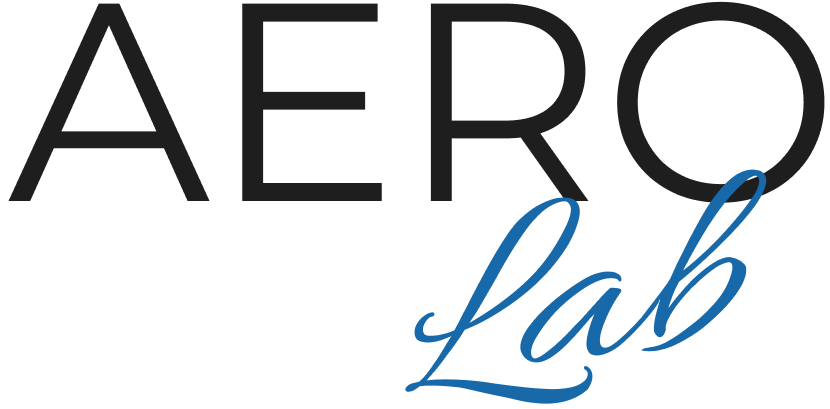

<p align="center">
  
</p>

<h1 align="center">AeroLab — 2D Wind Tunnel</h1>

<p align="center">
  <a href="LICENSE"></a>
  
  
  
  
</p>

<p align="center">
  A real-time, browser-based 2D computational fluid dynamics (CFD) workstation powered by a WebGL2 <strong>D2Q9 Lattice-Boltzmann</strong> solver with <strong>Smagorinsky Large Eddy Simulation (LES)</strong>. Load built-in or custom airfoils, reshape camber and thickness interactively, inspect live flow fields, benchmark against the <strong>NeuroFoil</strong> surrogate, and sync airfoils, pilot profiles, and simulation result summaries with Supabase.
</p>

---

## Features

### 3-Part Responsive Workstation (`/`)
- **Results Panel (Left)**: Live lift coefficient ($C_L$), drag coefficient ($C_D$), lift-to-drag ratio ($L/D$), simulated Reynolds number ($Re$), flow separation indicator (`Attached` / `Sep %` / `Stall`), **Analytics** (Plotly telemetry charts + live data sheet), and **NeuroFoil** surrogate & benchmark comparator.
- **2D Wind Tunnel Viewport (Center)**: GPU-accelerated `640 × 320` lattice-Boltzmann simulation canvas with adaptive steps-per-frame, live pause/resume, full parameter reset, and PNG flow snapshot export.
- **Controls Panel (Right)**: Organized into **Flow** (angle of attack $\alpha$ slider & quick presets, flow visualization mode, Reynolds number slider, and field guide), **Airfoils** (built-in catalog, drag-and-drop `.dat`/`.txt` uploader, and searchable Community Library), and **Shape** (interactive Bézier camber & thickness editor).
- **Header Navigation**: Toggle sidebars on desktop or switch full-screen views (**Results**, **Tunnel**, **Controls**) on mobile/tablet, plus direct access to the **Pilot Profile** route (`/profile`).

### Pilot Profile & Authentication (`/profile`)
- **Modern Sign-In & Registration**: Clean authentication screen supporting **Email / Password** (sign in or create account with password visibility toggle) and **Google OAuth** via Supabase Auth.
- **Customizable Pilot Profile**:
  - Upload and update your **profile avatar** and **profile cover banner** (stored in the `avatars` Supabase Storage bucket).
  - Edit pilot details including **Display Name**, **Role / Title**, **Organization**, **Location**, and **Bio / Description**.
- **Flight Envelope Summary & History**:
  - Track personal metrics (`Past Runs`, `Uploads`, `Best L/D`, and top-performing airfoil).
  - Browse past published runs, inspect stored result summaries, **replay** saved $\alpha$ / $Re$ / airfoil configurations in one click, and export histories as **CSV** or **JSON**.
  - Manage uploaded `.dat` airfoils with inline SVG geometry previews, `.dat` download, and direct loading into the wind tunnel.

### Supabase Database, Realtime & Storage Buckets
When configured via `supabase/schema.sql`, AeroLab connects to Supabase for authentication, Postgres persistence with Row-Level Security (RLS), live Realtime updates, and object storage across three buckets:

| Resource | Purpose |
|---|---|
| `public.user_profiles` | Owner-isolated pilot profile stats (`total_uploads`, `total_runs`, `best_ld`, `best_airfoil`) |
| `public.airfoils` | Public community airfoil metadata and normalized coordinates |
| `public.benchmarks` | Public simulation benchmark runs and leaderboard entries |
| `airfoils` bucket | Stores uploaded **`.dat` airfoil coordinate files** |
| `avatars` bucket | Stores **pilot avatar images** and **profile cover banners** |
| `results` bucket | Stores **simulation result summary JSON files** alongside database benchmark records |

### NeuroFoil Surrogate & Benchmark Comparison
- **Physics-Informed Surrogate (`src/lib/neurofoil.ts`)**: Extracts 7 geometric descriptors from the active coordinates (max camber, camber position, max thickness, thickness position, leading-edge radius, trailing-edge boat-tail angle, and aft reflex) to predict $-8^\circ \dots +20^\circ$ viscous polars at the active Reynolds number.
- **Live Guidance & 1-Click Optimal Jump**: Displays predicted optimal incidence ($\alpha^*$), peak $L/D$, stall angle ($\alpha_{\text{stall}}$), active flow regime, LBM-vs-NeuroFoil agreement `%`, and a **`Jump α*`** shortcut.
- **Custom Reference Overlay**: Load `.json`, `.csv`, or `.dat` polar files—or use any community airfoil—to overlay reference curves on the live telemetry charts and publish benchmark runs to the leaderboard.

### Flow Visualization Modes
- **Velocity**: Local flow speed normalized to freestream velocity ($\times U_\infty$).
- **Pressure ($C_p$)**: Domain and surface pressure coefficient field.
- **Vorticity**: Shear-layer and wake rotation rate ($U/c$), highlighting clockwise and counter-clockwise vortex shedding.
- **Smoke**: Passive tracer dye injected upstream to reveal streamlines, boundary-layer separation bubbles, and wake eddies.

### Interactive Bézier Shape Editor
- Automatically fits smooth Bézier camber and thickness curves to the active airfoil (`src/lib/lbm/bezierShape.js`).
- Drag camber or thickness control points in `ShapeEditor2D` to deform the airfoil and watch the wind tunnel flow field update immediately.
- Reset back to the original geometry or download the modified airfoil as a Selig `.dat` file.

### Graphs, Data Sheets & Exports
- **Telemetry Graph (Plotly.js)**: Switch between **History**, **$\alpha$ Polar** ($C_L$ / $C_D$ with NeuroFoil or reference overlay), and **$L/D$** efficiency curves, and export any plot as **PNG** or **SVG**.
- **Data Sheet**: Real-time tabular telemetry log (sample index, airfoil, $\alpha$, $Re$, $C_L$, $C_D$, $L/D$, separation %, flow state) with manual snapshot capture, clear action, and **CSV** / **JSON** export.
- **Viewport & Geometry Exports**: Save the live WebGL2 flow canvas as a **PNG** snapshot and export active airfoil coordinates as **`.dat`**.

---

## Airfoil Support & `.dat` Parser

Built-in airfoils included in `public/examples/`:
- **NACA 0012** (`public/examples/naca0012.dat`)
- **NACA 4412** (`public/examples/naca4412.dat`)
- **Clark Y** (`public/examples/clarky.dat`)
- **Selig S1223** (`public/examples/s1223.dat`)
- **Eppler 387** (`public/examples/e387.dat`)

Custom `.dat` / `.txt` uploads (`src/lib/airfoilParser.js`) support both **Selig** (trailing edge → upper surface → leading edge → lower surface → trailing edge) and **Lednicer** (separate upper/lower leading-to-trailing surfaces) formats up to 1 MB, with automatic winding-order repair, duplicate removal, and whitespace normalization.

---

## Keyboard Shortcuts

| Key | Action |
|---|---|
| `Space` | Pause / Resume simulation |
| `↑` / `↓` | Adjust angle of attack ($\pm 0.5^\circ$, range $-20^\circ$ to $+25^\circ$) |
| `←` / `→` | Adjust simulated Reynolds flow speed |
| `R` | Reset flow parameters, geometry, and lattice state |

---

## Tech Stack & Project Structure

- **Frontend**: React 19, TypeScript, React Router DOM 7, Vite 8, Tailwind CSS v4, Plotly.js, Lucide Icons
- **Backend / Cloud**: Supabase (`@supabase/supabase-js`) — Auth (Email/Password + Google OAuth), Postgres + RLS + Realtime, Storage (`airfoils`, `avatars`, `results`)
- **CFD Solver**: Custom WebGL2 (`EXT_color_buffer_float`) D2Q9 Smagorinsky LES solver (`src/lib/lbm/tunnel2d.js`)
- **Surrogate & Parameterization**: NeuroFoil aerodynamic surrogate (`src/lib/neurofoil.ts`) & Bézier geometry fitter (`src/lib/lbm/bezierShape.js`)

```text
├── .env.example                    # Supabase environment variable template
├── index.html                      # Application HTML entry point
├── package.json                    # Dependencies and npm scripts
├── tsconfig.json                   # TypeScript configuration
├── vite.config.ts                  # Vite & Tailwind CSS configuration
├── supabase/
│   └── schema.sql                  # Postgres tables, RLS policies, Realtime & Storage buckets
├── public/
│   ├── examples/                   # Bundled .dat airfoil coordinate files
│   ├── aerolab-logo.png            # AeroLab brand logo
│   └── favicon.png                 # App icon
└── src/
    ├── App.tsx                     # Routes (/ & /profile) & 3-part CFD workstation
    ├── main.tsx                    # React entry point with BrowserRouter & SupabaseProvider
    ├── theme.css                   # Tailwind v4 theme tokens & custom control styles
    ├── types.ts                    # Shared TypeScript interfaces
    ├── plotly.d.ts                 # Ambient module types for plotly.js-basic-dist-min
    ├── pages/
    │   └── ProfilePage.tsx         # Sign-in screen & Pilot Profile (avatar/cover upload, bio, runs, airfoils)
    ├── components/
    │   ├── AirfoilPicker.tsx       # Built-in, custom .dat & Supabase Community airfoil browser
    │   ├── BenchmarkComparison.tsx # NeuroFoil surrogate, reference overlay & benchmark publisher
    │   ├── ResultsAnalytics.tsx    # Plotly Telemetry Graph (PNG/SVG) & Data Sheet (CSV/JSON)
    │   ├── ShapeEditor2D.tsx       # Interactive Bézier camber/thickness airfoil editor
    │   ├── SupabaseProvider.tsx    # Supabase Auth, Pilot Profile & Realtime collection sync
    │   └── ui.tsx                  # Shared sliders, alerts, file dropzone & parser diagnostics
    ├── utils/
    │   └── supabase.ts             # Supabase client initialization
    └── lib/
        ├── airfoilParser.js        # Selig/Lednicer .dat parser & coordinate normalizer
        ├── airfoilRepository.ts    # Supabase DB CRUD, Storage bucket uploads & reference parsers
        ├── files.js                # FileReader, CSV serializer & download utilities
        ├── neurofoil.ts            # NeuroFoil geometry feature extractor & polar surrogate
        └── lbm/
            ├── bezierShape.js      # Bézier airfoil fitting & curve generation
            └── tunnel2d.js         # WebGL2 D2Q9 Lattice-Boltzmann 2D wind tunnel solver
```

---

## Local Development & Supabase Setup

### Prerequisites
- **Node.js 18+**
- A modern browser with **WebGL2** and `EXT_color_buffer_float` support
- A **Supabase** project (optional for local offline CFD simulation; required for Auth, Community Airfoils, Cloud Benchmarks, and Storage buckets)

### 1. Install Dependencies

```bash
npm install
```

### 2. Configure Environment Variables

Copy `.env.example` to `.env` and add your Supabase project credentials:

```env
VITE_SUPABASE_URL="https://your-project-id.supabase.co"
VITE_SUPABASE_PUBLISHABLE_KEY="your-supabase-publishable-or-anon-key"
```

### 3. Initialize Supabase Database & Storage Buckets

Open the **SQL Editor** in your Supabase Dashboard and execute `supabase/schema.sql`. This provisions:
- `public.user_profiles`, `public.airfoils`, and `public.benchmarks` tables with Row-Level Security policies
- `supabase_realtime` publication subscriptions for live updates
- Public Storage buckets `airfoils`, `avatars`, and `results` with access policies

*(Optional)* To enable Google Sign-In, configure the **Google** OAuth provider under **Authentication → Providers** in your Supabase Dashboard and add your app URL to the redirect allow-list.

### 4. Run the Development Server

```bash
npm run dev
```

Open `http://localhost:3000` in your browser.

### Available Scripts

| Script | Description |
|---|---|
| `npm run dev` | Start the Vite development server on port `3000` |
| `npm run build` | Build the production bundle into `dist/` |
| `npm run preview` | Preview the production build locally |
| `npm run lint` | Run TypeScript type checks (`tsc --noEmit`) |
| `npm run clean` | Remove the `dist/` build directory |

---

## Acknowledgements

The 2D Lattice-Boltzmann solver is adapted from the [Kutta](https://github.com/crgimenes/kutta) open-source flow visualizer by Cesar Gimenes (MIT License).

---

## License

This project is licensed under the GNU Affero General Public License v3.0. See [LICENSE](LICENSE) for details.
